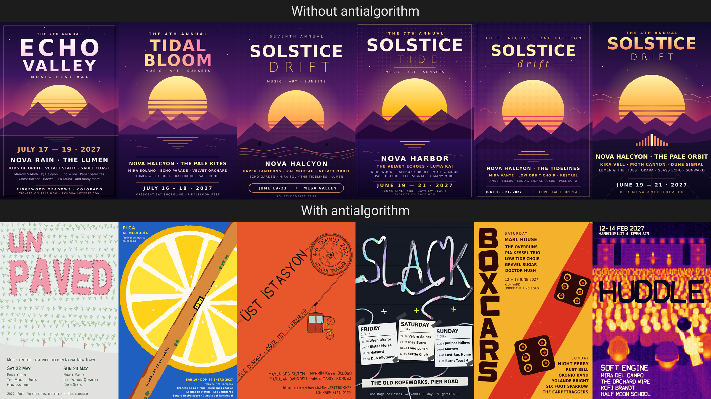
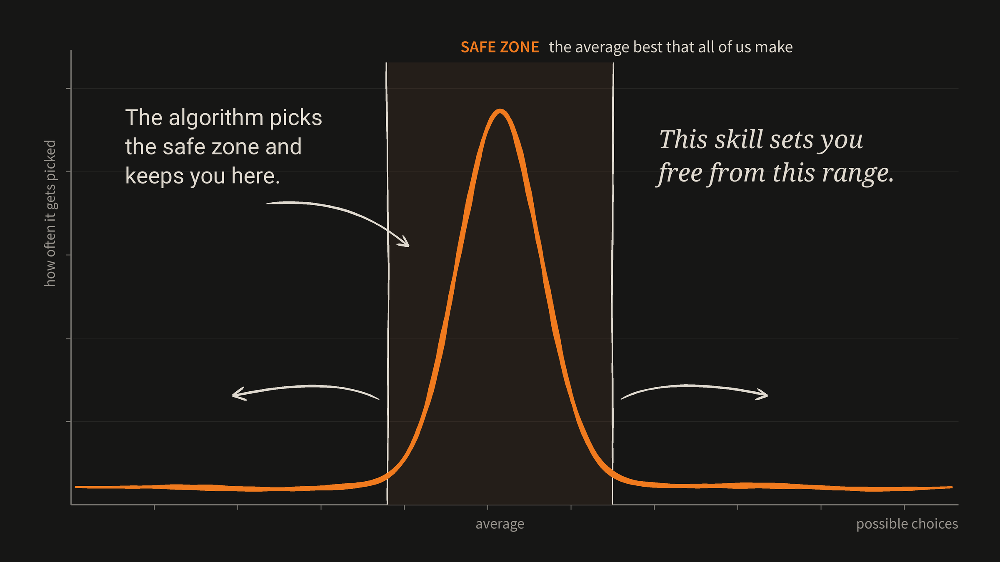

# Be inventive

An agent skill for creative work: names, copy, stories, game ideas, posters, and interfaces. It helps an agent notice its obvious first answer, then move away from it for a reason grounded in the project.



The comparison above uses the same prompt for both rows. The top row shows six runs without the skill; the lower row was selected from about a dozen runs made while the original skill was being written.



## Install

This is a plain Agent Skills folder with a `SKILL.md` entry point. Copy this adapted folder to the skills directory your agent reads. For Codex, use `~/.agents/skills/be-inventive` for a user-level install or `.agents/skills/be-inventive` inside a project. Other agents may use a different skills directory. The skill has no dependency on a particular model provider or API.

The seed and move-log commands work on Windows, macOS, and Linux. Use PowerShell on Windows and Bash on macOS/Linux; the Bash scripts avoid Bash 4-only features, so macOS's system Bash works. The seed values are shared in `data/seeds.tsv`; there are no Python scripts or Python packages in this version.

## Seed command

When a request has little context and the user wants you to proceed, generate a seed from the skill folder. On Windows:

```powershell
pwsh -File scripts/seed.ps1 visual
pwsh -File scripts/seed.ps1 text
pwsh -File scripts/seed.ps1 idea
pwsh -File scripts/seed.ps1 visual -Keep "method=x-ray image" -Only color
pwsh -File scripts/seed.ps1 idea -NoLog
```

On macOS or Linux, use Bash:

```sh
bash scripts/seed.sh visual
bash scripts/seed.sh text
bash scripts/seed.sh idea
bash scripts/seed.sh visual --keep "method=x-ray image" --only color
bash scripts/seed.sh idea --no-log
```

Each seed type picks from a different set of creative prompts. Recent picks are recorded in `history.tsv` to reduce repetition. `-Keep` / `--keep` holds an axis, `-Only` / `--only` rerolls one axis, and `-NoLog` / `--no-log` skips the history file.

## Move log

Keep the main move behind recent work so the skill can avoid repeating its own successful tricks:

```powershell
pwsh -File scripts/moves.ps1
pwsh -File scripts/moves.ps1 add "poster: x-ray method, deep blue ground, text cut by the edge"
```

```sh
bash scripts/moves.sh
bash scripts/moves.sh add "poster: x-ray method, deep blue ground, text cut by the edge"
```

## Visual guidance

Visual rules live in `visuals.md`. When an image-generation tool is available, the skill can use it. In text-only environments, it can instead make a vector/code visual or provide a ready-to-use prompt. Use any rendering and inspection tools already available; the skill itself does not install or depend on a renderer.

## Attribution

This skill is adapted from [Manki Dev's `antialgorithm`](https://github.com/mankidev/antialgorithm). The original skill and its retained visual guidance are credited to Manki Dev; the original MIT license and copyright notice are preserved in [`LICENSE`](LICENSE). This adaptation renames the skill, replaces the Python seed and move-log scripts with PowerShell and Bash command-line versions, and adds image-generation-aware guidance.

## License

MIT. See [`LICENSE`](LICENSE).
